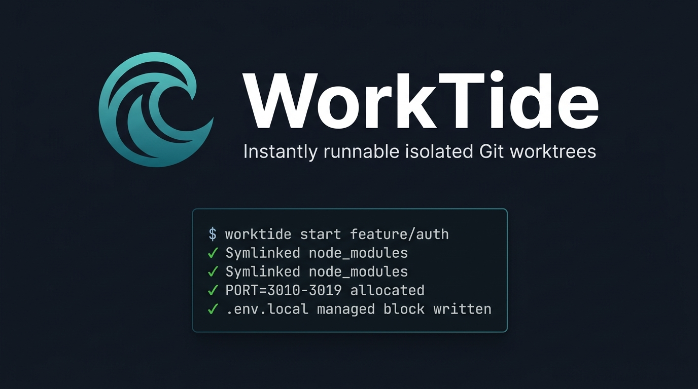
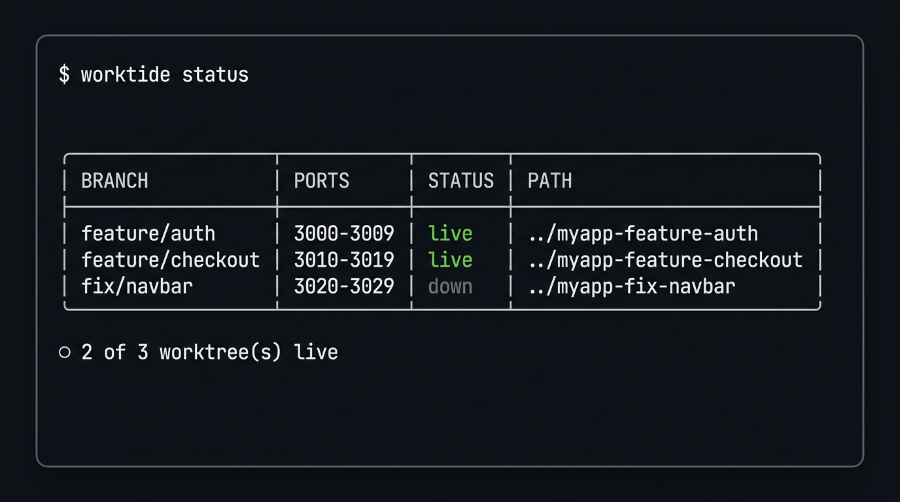

<p align="center">
  
</p>

<p align="center">
  <a href="https://github.com/dev-harshvats/worktide/actions/workflows/ci.yml">
    
  </a>
  
  
  
  
</p>

<p align="center">
  <b>Your agent creates the worktree. WorkTide makes it run.</b><br>
  Dependencies linked. <code>.env</code> propagated. A dedicated port range. Zero config. Zero collisions.
</p>

---

## Why

AI coding agents — Claude Code, Cursor — spin up git worktrees for parallel branch work. But a fresh worktree is inert:

```bash
git worktree add ../feature-auth feature/auth && cd ../feature-auth
# node_modules? gone.   .env? gone.
# dev-server port? same as main — EADDRINUSE on every npm run dev.
```

**WorkTide is the one command that makes a fresh worktree immediately runnable** — dependencies linked, environment copied, a unique 10-port range injected into `.env.local`. No reinstalls. No port collisions. No shared state.

---

## Quickstart

```bash
# Install globally or link in your repo
npm install -g worktide

# Start a fully provisioned, isolated worktree
worktide start feature/auth
# ✓ Symlinked node_modules from primary checkout
# ✓ Propagated .env, .env.development
# ✓ PORT=3010, PORT_END=3019 → .env.local managed block

# cd into it and run your dev server — it's already wired up
cd ../myapp-feature-auth && npm run dev

# See all active worktrees and their port liveness
worktide status

# Tear down cleanly when the branch is merged
worktide done feature/auth
```

---

## Status dashboard

<p align="center">
  
</p>

`worktide status` shows every active worktree, its allocated port block, and real-time socket liveness — whether your dev server is actually running (`live`) or stopped (`down`).

---

## Environment isolation

Each worktree receives a unique, collision-free 10-port block registered in a centralized SQLite registry:

```bash
worktide start feat/auth       # PORT 3000-3009
worktide start feat/checkout   # PORT 3010-3019
worktide start fix/navbar      # PORT 3020-3029
```

Values land in a **managed block** in `.env.local` alongside — never overwriting — your own secrets:

```dotenv
STRIPE_SECRET_KEY=sk_live_…      # your line, always preserved

# >>> worktide managed >>>
PORT=3010
PORT_END=3019
# <<< worktide managed <<<
```

- **Gap-reuse allocator:** When a worktree is torn down, its port range is released and reused by the next allocation — ports stay low and predictable, never growing unbounded toward `:65535`.
- **OS socket probing:** Before reserving a candidate range, WorkTide probes each port via `net.createServer`. If an external process (Docker, Postgres) already owns it, WorkTide skips to the next free block automatically.
- **Concurrency-safe:** The SQLite registry runs in **WAL mode** with `PRAGMA foreign_keys = ON`. Parallel CLI invocations can't double-allocate the same ports — verified in a 10-worker concurrent stress test.

---

## Commands

| Command | What it does |
|---------|-------------|
| `worktide start <branch>` | Create a worktree, symlink `node_modules`, copy `.env*`, allocate ports, write `.env.local`. Atomic rollback on any failure. |
| `worktide status [--json] [-a]` | Tabular view of all active worktrees — branch, port range, socket liveness, path. |
| `worktide done <branch> [--force]` | Verify git cleanliness, kill processes on allocated ports, remove worktree, release ports. |
| `worktide doctor [--fix]` | Detect broken symlinks, orphaned registry records, and stale git locks. Auto-repair with `--fix`. |

---

## Atomic rollback

If `worktide start` fails at any step — git error, full disk, bad branch name — it unwinds every side-effect in reverse order:

1. Delete propagated `.env*` files
2. `git worktree remove --force`
3. Release port allocation from SQLite
4. Mark worktree record as `removed`

No orphaned directories. No leaked port reservations. No partial state.

---

## Self-healing doctor

Deleted a worktree manually with `rm -rf`? Ran `git worktree remove` without telling WorkTide? Run:

```bash
worktide doctor       # see what's inconsistent
worktide doctor --fix # repair automatically
```

Detects and repairs:
- Broken `node_modules` symlinks pointing to missing targets
- Orphaned registry records with no matching directory or git entry
- Stale `.git/index.lock` files left by crashed git processes

---

## Repository structure

```
worktide/
├── bin/               ← CLI executable entrypoint (shebang)
├── src/
│   ├── cli.js         ← Commander definitions & error boundary
│   ├── commands/      ← start · status · done · doctor
│   ├── db/            ← SQLite WAL connection, schema, queries
│   ├── services/      ← git · ports · env · sync · procs · doctor
│   └── utils/         ← errors (exit codes) · logger · slug
├── test/              ← 15 Vitest test suites, 55 tests
└── docs/              ← SRS · System Design · Interview Guide
```

---

## Testing

```bash
npm test            # run all 55 tests across 15 suites
npm run test:watch  # watch mode
```

---

<p align="center">
  MIT License · <a href="https://github.com/dev-harshvats">Harsh Vats</a><br>
  <a href="docs/DESIGN.md">System Design</a> · <a href="docs/learning/interview-guide.md">Interview Guide</a> · <a href="ROADMAP.md">Roadmap</a>
</p>
