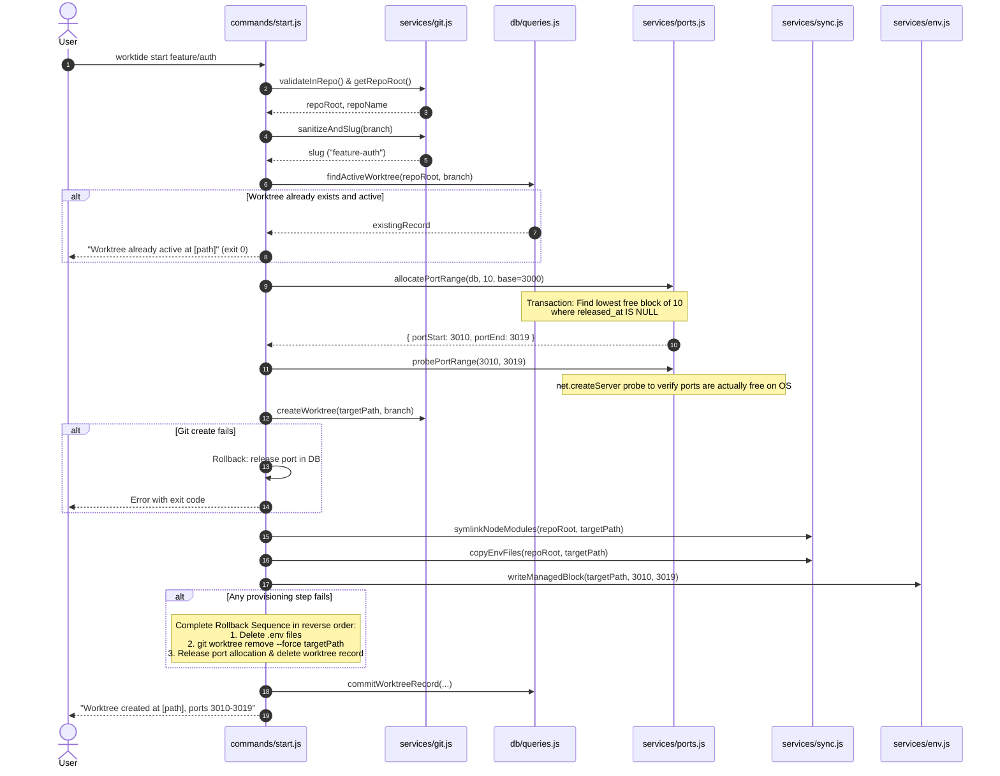
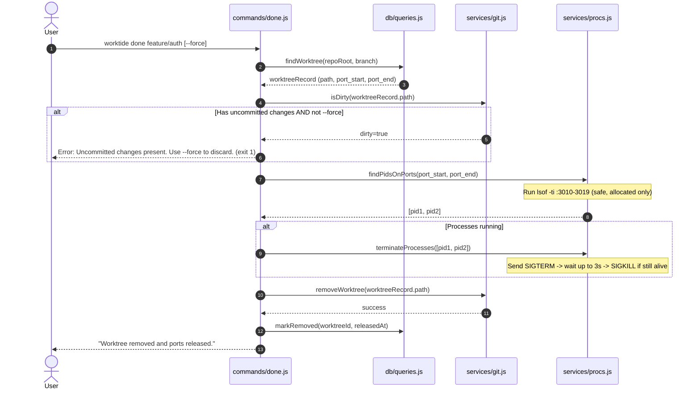

# WorkTide — Architecture & System Design

**Document Version:** 1.0.0  
**Author:** Harsh Vats  
**Status:** Approved for Implementation (Phase 0)  

---

## 1. System Architecture

WorkTide follows a strict layered architecture with unidirectional dependencies. Higher layers orchestrate and format output; lower layers perform computations and mutations without side effects on console I/O.

```
┌────────────────────────────────────────────────────────┐
│                   CLI Entrypoint                       │
│             (bin/worktide.js, src/cli.js)              │
│                Commander command parsing               │
└──────────────────────────┬─────────────────────────────┘
                           │
┌──────────────────────────▼─────────────────────────────┐
│                   Command Handlers                     │
│           (src/commands/{start,status,done,doctor})    │
│  - Parses flags & user arguments                       │
│  - Orchestrates domain services                        │
│  - Emits user-facing output (stdout) & errors (stderr) │
└─────────────┬───────────────────────────┬──────────────┘
              │                           │
┌─────────────▼──────────────┐ ┌──────────▼──────────────┐
│       Domain Services      │ │      Utilities / Core   │
│     (src/services/*.js)    │ │    (src/utils/*.js)     │
│  - git.js    (execa wrapper)│ │  - logger.js           │
│  - ports.js  (allocation)  │ │  - errors.js (types)    │
│  - env.js    (managed blk) │ │  - slug.js              │
│  - sync.js   (symlink/copy)│ └─────────────────────────┘
│  - procs.js  (lsof & kill) │
│  * Strictly ZERO console IO│
└─────────────┬──────────────┘
              │
┌─────────────▼──────────────┐
│      Registry Layer        │
│       (src/db/*.js)        │
│  - SQLite (better-sqlite3) │
│  - WAL mode + Foreign Keys │
│  - Atomic transactions     │
└────────────────────────────┘
```

### Architectural Principles
1. **Layer Purity:** Services NEVER write to `console.log` or `console.error`. They return typed results or throw domain-specific custom errors (`WorktideError`).
2. **Commands Handle I/O:** Command handlers catch errors, extract exit codes, and format messages for humans or JSON consumers.
3. **Shell Safety:** All external invocations (`git`, `lsof`, `kill`) use `execa` with structured argument arrays. Never use raw concatenated shell strings (`sh -c`).
4. **Idempotence & Predictability:** Re-running commands with identical parameters will not create duplicate entries or crash.

---

## 2. Directory and File Structure

```
worktide/
├── bin/
│   └── worktide.js          # Executable entrypoint (shebang, links to src/cli.js)
├── src/
│   ├── cli.js               # Commander definition and global options
│   ├── commands/
│   │   ├── start.js         # "start <branch>" command handler & rollback
│   │   ├── status.js        # "status" command handler (table + --json)
│   │   ├── done.js          # "done <branch>" command handler
│   │   └── doctor.js        # "doctor" inspection and --fix handler
│   ├── services/
│   │   ├── git.js           # Git operations (root, worktree add/rm, status, slug)
│   │   ├── ports.js         # Transactional port allocation and gap finder
│   │   ├── env.js           # .env.* copy and .env.local managed block parser/writer
│   │   ├── sync.js          # Symlink node_modules, copy files safely
│   │   └── procs.js         # lsof port lookup, process signal handling (SIGTERM/SIGKILL)
│   ├── db/
│   │   ├── connection.js    # SQLite connection factory (WAL, foreign_keys, path resolution)
│   │   ├── schema.sql       # DDL definitions and index creation
│   │   └── queries.js       # Prepared statements and transactional helpers
│   └── utils/
│       ├── errors.js        # Custom error classes with exit codes
│       ├── logger.js        # Formatted console output helper
│       └── slug.js          # Safe slug generator for branch paths
├── test/                    # Automated test suites (Vitest)
├── docs/
│   ├── SRS.md               # Requirements specification
│   ├── DESIGN.md            # Architecture & flow specification
│   └── learning/            # Phase-by-phase interview notes
├── package.json
├── LICENSE
└── README.md
```

---

## 3. Database Specification

- **Storage Engine:** SQLite via `better-sqlite3`.
- **Default Path:** `~/.config/worktide/registry.db`.
- **Test Override:** Environment variable `WORKTIDE_HOME` (resolves to `$WORKTIDE_HOME/registry.db`).
- **Pragmas:** 
  - `PRAGMA foreign_keys = ON;` (cascading deletes enforced)
  - `PRAGMA journal_mode = WAL;` (concurrent reader-writer isolation)
  - `PRAGMA busy_timeout = 5000;` (prevent immediate lock failures under concurrency)

### Database Schema (DDL)

```sql
CREATE TABLE IF NOT EXISTS repos (
  id INTEGER PRIMARY KEY AUTOINCREMENT,
  root_path TEXT NOT NULL UNIQUE,
  name TEXT NOT NULL,
  created_at TEXT NOT NULL DEFAULT (datetime('now'))
);

CREATE TABLE IF NOT EXISTS worktrees (
  id INTEGER PRIMARY KEY AUTOINCREMENT,
  repo_id INTEGER NOT NULL REFERENCES repos(id) ON DELETE CASCADE,
  branch TEXT NOT NULL,
  slug TEXT NOT NULL,
  path TEXT NOT NULL UNIQUE,
  status TEXT NOT NULL CHECK (status IN ('active', 'removed')) DEFAULT 'active',
  created_at TEXT NOT NULL DEFAULT (datetime('now')),
  removed_at TEXT,
  UNIQUE (repo_id, branch)
);

CREATE TABLE IF NOT EXISTS port_allocations (
  id INTEGER PRIMARY KEY AUTOINCREMENT,
  worktree_id INTEGER NOT NULL REFERENCES worktrees(id) ON DELETE CASCADE,
  port_start INTEGER NOT NULL,
  port_end INTEGER NOT NULL CHECK (port_end >= port_start),
  allocated_at TEXT NOT NULL DEFAULT (datetime('now')),
  released_at TEXT
);

-- Ensure no overlapping active port ranges across any repo
CREATE UNIQUE INDEX IF NOT EXISTS idx_active_port_start 
  ON port_allocations(port_start) 
  WHERE released_at IS NULL;

CREATE INDEX IF NOT EXISTS idx_worktrees_repo 
  ON worktrees(repo_id, status);
```

---

## 4. Key Workflows & Sequences

### 4.1. `worktide start <branch>`



### 4.2. `worktide done <branch>`



### 4.3. `worktide status [--json]`
1. Connects to SQLite registry.
2. Fetches all worktrees associated with the current repo (or all repos).
3. For each active worktree, inspects `port_start` with `net.connect` or quick socket probe to determine `live` vs `down`.
4. Outputs formatted terminal table or JSON array if `--json` is supplied.

### 4.4. `worktide doctor [--fix]`
1. **Broken Symlink Check:** Inspects `node_modules` in each active worktree. Flags if symlink is broken or targets a non-existent path.
2. **Orphaned Allocation Check:** Finds worktrees recorded as `active` in the registry whose filesystem path or git worktree no longer exists.
3. **Stale Lock Check:** Checks for stale `.git/index.lock` or `.git/worktrees/<name>/locked` files.
4. If `--fix` is passed:
   - Repairs or recreates broken symlinks if root `node_modules` exists.
   - Marks orphaned DB records as `removed` and releases allocated ports.
   - Removes stale lock files older than threshold (if safe).

---

## 5. Managed Environment Block Format

The managed block in `.env.local` strictly follows this pattern:

```env
# >>> worktide managed >>>
PORT=3010
PORT_END=3019
# <<< worktide managed <<<
```

### Parsing & Injection Rules:
- If `.env.local` does not exist, it is created with the managed block.
- If `.env.local` exists and contains `# >>> worktide managed >>> ... # <<< worktide managed <<<`, only the content between those markers is replaced.
- All lines before and after the block (e.g., custom user variables, comments) are preserved verbatim.
- If markers are missing, the block is appended to the end of the file.

---

## 6. Identified Gaps, Clarifications & Design Decisions

Before starting implementation in Phase 1, the following details are documented for approval:

1. **Worktree Directory Placement:**
   - *Proposal:* Place worktrees in a sibling directory: `../<repo-name>-<branch-slug>` (e.g. `../myrepo-feat-auth`).
   - *Alternative:* Subdirectory inside repo root (e.g. `<repo-root>/.worktrees/<branch-slug>`).
   - *Recommendation:* Sibling directory `../<repo-name>-<branch-slug>` avoids git nesting issues and matches standard worktree ergonomics.

2. **Branch Creation Policy:**
   - If `worktide start <branch>` is run and `<branch>` does not exist yet:
   - *Proposal:* `git worktree add -b <branch> <path>` automatically creates the branch from current HEAD. If the branch already exists: `git worktree add <path> <branch>`.

3. **Port Probing & Collisions:**
   - If SQLite finds a free range in the registry (e.g., 3000–3009), but OS port probing detects that port 3000 is occupied by an external service (not managed by WorkTide):
   - *Proposal:* The allocator increments to the next candidate range and probes again until a truly vacant 10-port block is found.

4. **Environment Copy vs. Managed Block Precedence:**
   - FR-3 copies `.env*` files. FR-5 writes `.env.local`.
   - *Rule:* Copy `.env`, `.env.*` first. Then write/update the managed block in `.env.local`. Since Next.js / Vite / dotenv prioritize `.env.local` over `.env`, the WorkTide `PORT` will naturally take precedence.

5. **`worktide status` Scope:**
   - *Proposal:* By default, filter status to worktrees belonging to the current repository. Provide `--all` flag to inspect all repositories tracked in the registry.
